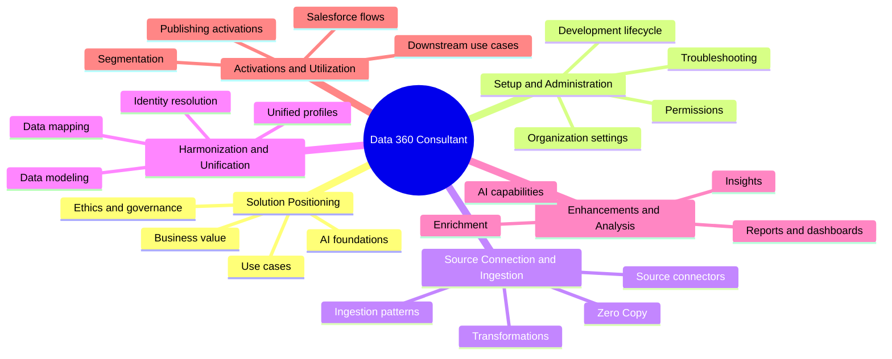
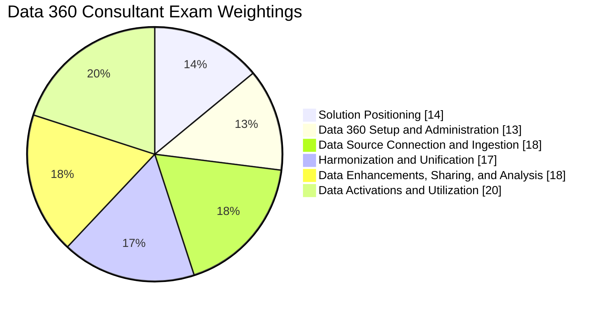
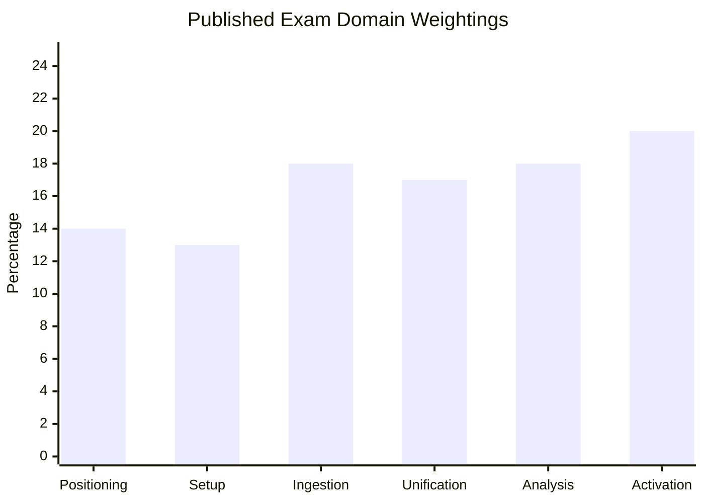
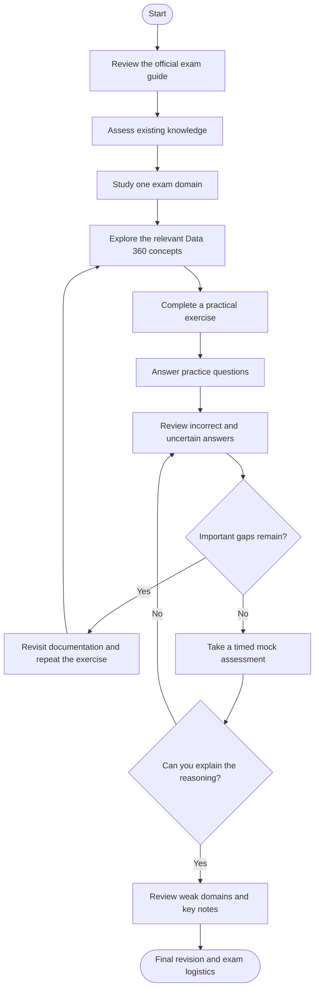
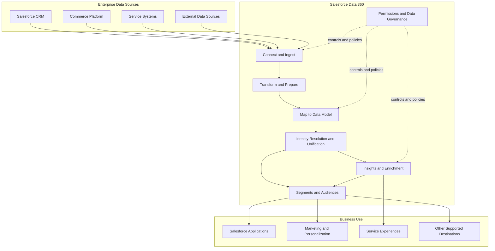
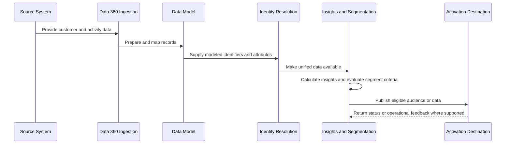
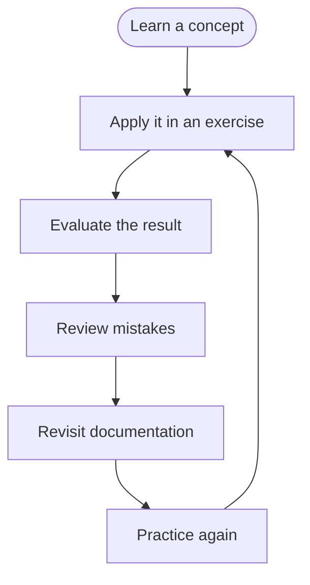
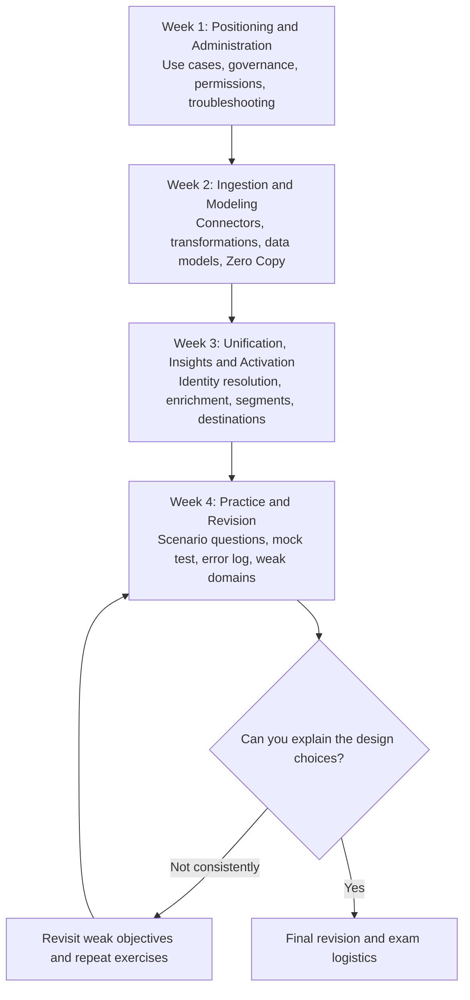

# Salesforce Certified Data 360 Consultant (Data-Con-101) Study Guide

A practical study guide for preparing for the Salesforce Certified Data 360 Consultant certification, formerly known as Salesforce Certified Data Cloud Consultant. Learn how to connect enterprise data, transform and model it, unify customer identities, manage governance, build insights, create segments, and activate data across business applications.

This repository combines official Salesforce documentation, independent study recommendations, conceptual architecture diagrams, hands-on project ideas, and original practice questions.

> **Official starting point:** [Salesforce Certified Data 360 Consultant Exam Guide](https://help.salesforce.com/s/articleView?id=005298940&language=en_US&type=1)

> **Supplementary study resource:** [CertsGate — Data-Con-101](https://certsgate.com/exams/salesforce/data-con-101)

---

## Table of Contents

- [Overview](#overview)
- [About the Certification](#about-the-certification)
- [Who Should Prepare?](#who-should-prepare)
- [Skills and Knowledge Areas](#skills-and-knowledge-areas)
- [Official Exam Objectives and Weightings](#official-exam-objectives-and-weightings)
- [Preparation Flowchart](#preparation-flowchart)
- [Data 360 Conceptual Architecture](#data-360-conceptual-architecture)
- [Data Processing and Activation Workflow](#data-processing-and-activation-workflow)
- [Circular Study and Revision Cycle](#circular-study-and-revision-cycle)
- [Step-by-Step Preparation Guide](#step-by-step-preparation-guide)
- [Four-Week Study Roadmap](#four-week-study-roadmap)
- [Practice Questions](#practice-questions)
- [Hands-On Projects](#hands-on-projects)
- [Common Preparation Mistakes](#common-preparation-mistakes)
- [Career Relevance](#career-relevance)
- [Frequently Asked Questions](#frequently-asked-questions)
- [Official and Additional Learning Resources](#official-and-additional-learning-resources)
- [About CertsGate](#about-certsgate)

---

## Overview

Organizations often store customer information across several systems, such as CRM applications, commerce platforms, service tools, marketing systems, and external data sources. These systems may use different identifiers and data structures, making it difficult to understand a customer's complete relationship with the business.

Salesforce Data 360 helps organizations bring data together, harmonize it into useful models, resolve customer identities, derive insights, create audiences, and activate information for business use cases.

The Salesforce Certified Data 360 Consultant certification focuses on the skills needed to position, design, configure, and implement Data 360 solutions. Preparation involves understanding the platform's terminology and architecture, but it also requires judgment about data quality, governance, identity resolution, integration patterns, and activation requirements.

This study guide organizes those subjects into a practical learning path. It is intended to complement official Salesforce documentation and hands-on experience, not replace them.

## About the Certification

The **Salesforce Certified Data 360 Consultant** credential is intended for professionals who implement and consult on enterprise data platforms in customer-facing roles. The work can involve data strategy, data modeling, source integration, unification, governance, analytics, segmentation, and activation.

Salesforce's official materials previously used the name **Salesforce Certified Data Cloud Consultant**. The current product and certification naming has evolved to Data 360, so older training resources may still use Data Cloud terminology.

### Published exam information

| Detail | Official guide information |
|---|---|
| Current credential name | Salesforce Certified Data 360 Consultant |
| Former name | Salesforce Certified Data Cloud Consultant |
| Provider | Salesforce |
| Supplied CertsGate identifier | Data-Con-101 |
| Question format | 60 multiple-choice questions plus up to five unscored questions |
| Time limit | 105 minutes |
| Passing score | 70% |
| Exam version shown in the current guide | Spring '26 release |
| Prerequisite | None listed in the guide |
| Delivery | Proctored testing center or online, subject to current availability |
| Recommended preparation | A combination of practical experience and self-study |

Exam details and product terminology can change. Check the [official exam guide](https://help.salesforce.com/s/articleView?id=005298940&language=en_US&type=1) before registering.

## Who Should Prepare?

This certification may be relevant to:

- Salesforce consultants working on enterprise data implementations.
- Salesforce administrators expanding into data platform configuration.
- Data architects and solution architects working with customer data.
- Business analysts involved in data strategy and customer-data use cases.
- Integration specialists connecting Salesforce with external systems.
- Technical marketers working with segmentation and activation.
- Data and CRM professionals supporting analytics and personalization.

A candidate should ideally be comfortable with data structures, data integration concepts, and customer-facing solution design. Experience with Salesforce administration or other enterprise data platforms can provide a useful foundation.

If you are new to Data 360, start with the platform's purpose, core terminology, and data lifecycle before moving into identity resolution, insights, and activation.

## Skills and Knowledge Areas

The official exam guide groups the certification into six domains.

| Domain | Key concepts |
|---|---|
| Solution Positioning | Business value, platform terminology, use cases, AI foundations, data ethics, and governance |
| Data 360 Setup and Administration | Permissions, organization settings, governance configuration, development lifecycle, and troubleshooting |
| Data Source Connection and Ingestion | Source connectors, ingestion considerations, transformations, and Zero Copy |
| Harmonization and Unification | Data modeling, mapping, identity resolution, and unified customer data |
| Data Enhancements, Sharing, and Analysis | Enrichment, insights, sharing data with other systems, reports, dashboards, and AI capabilities |
| Data Activations and Utilization | Segmentation, publishing activations, using data in business processes, and Data 360 with flows |

### Concept map

This map is an independent study overview, not an official exam weighting.

## Official Exam Objectives and Weightings

The following percentages are published in the current Salesforce Certified Data 360 Consultant exam guide.

| Official exam domain | Weight |
|---|---:|
| Solution Positioning | 14% |
| Data 360 Setup and Administration | 13% |
| Data Source Connection and Ingestion | 18% |
| Harmonization and Unification | 17% |
| Data Enhancements, Sharing, and Analysis | 18% |
| Data Activations and Utilization | 20% |
| **Total** | **100%** |

### Exam domain weightage: pie chart

### Exam domain weightage: bar chart

### How to prioritize your preparation

Data Activations and Utilization is the largest domain at 20%. Give segmentation, publishing activations, downstream use cases, and Data 360 integration with Salesforce flows substantial attention.

Data Source Connection and Ingestion, along with Data Enhancements, Sharing, and Analysis, each account for 18%. Practice source selection, ingestion considerations, transformations, insights, and the appropriate use of data across systems.

Harmonization and Unification is also important. Understand how data mapping, models, identifiers, and identity resolution contribute to a unified view of customers.

Do not ignore the smaller domains. Solution positioning and administration include business value, governance, permissions, lifecycle management, and troubleshooting.

**Official source:** [Salesforce Certified Data 360 Consultant Exam Guide](https://help.salesforce.com/s/articleView?id=005298940&language=en_US&type=1)

## Preparation Flowchart

Use this study process to move from the exam objectives to practical understanding. If an assessment reveals a significant gap, revisit the relevant documentation and repeat the exercise before continuing.

The purpose of this process is to build transferable knowledge rather than memorizing isolated answers.

## Data 360 Conceptual Architecture

Data 360 implementations can involve multiple data sources, ingestion mechanisms, data models, identity resolution, insights, segments, and activation destinations.

The diagram below illustrates a common conceptual workflow. It is not a mandatory architecture for every Salesforce implementation; the appropriate components depend on the organization's requirements, data sources, licensing, and supported integration patterns.

### What to understand in each layer

**Data sources and ingestion:** Learn how source systems provide information, how ingestion choices affect freshness and processing, and what needs to be considered before connecting a source.

**Transformation and modeling:** Understand how data is prepared and mapped into an appropriate model. Poor mappings or inconsistent identifiers can undermine downstream results.

**Identity resolution and unification:** Learn how records that may represent the same person or entity can be evaluated and unified according to configured rules. Unification depends on data quality, available identifiers, and the chosen configuration.

**Insights and activation:** Understand how prepared data can support calculations, reporting, segmentation, personalization, and downstream business actions.

**Governance:** Permissions, policies, and data ethics are part of solution design. They should be considered throughout the data lifecycle, not added only after implementation.

## Data Processing and Activation Workflow

The next diagram follows a conceptual example: a company wants to identify customers who may be eligible for a service campaign.

This sequence is illustrative. Actual processing order, available capabilities, activation behavior, and feedback mechanisms depend on the configured solution and destination.

## Circular Study and Revision Cycle

Data 360 combines multiple connected concepts. Revisiting them in a cycle helps reveal how a mistake in one area—such as data mapping—can affect unification, insights, and activation.

Maintain an error log with:

- **Domain:** Which exam objective was involved?
- **Problem:** What did you misunderstand?
- **Reasoning:** Why is the correct approach appropriate?
- **Next step:** What documentation or exercise will help?
- **Follow-up:** Can you answer a similar question later without assistance?

## Step-by-Step Preparation Guide

### 1. Understand Data 360's purpose and positioning

Begin with the business problems Data 360 is designed to address. Learn its terminology, value proposition, common use cases, and role in supporting data-driven experiences and AI-related capabilities.

Study data ethics and governance alongside platform capabilities. Consider consent, access, appropriate data use, and the consequences of using incomplete or inaccurate customer information.

For each scenario, ask:

- What business outcome is required?
- What data is available?
- What is missing or unreliable?
- Which Data 360 capability is relevant?
- What governance requirements must be respected?

### 2. Learn setup and administration

Review permissions, permission sets, organization-level configuration, available tooling, development lifecycle considerations, and troubleshooting.

Practice thinking through the difference between a configuration problem and a data problem. A user may be unable to access a feature because of permissions, while an unexpected analytical result may originate from ingestion, mapping, transformation, or model configuration.

Develop a troubleshooting habit: identify the symptom, narrow down the affected layer, inspect relevant configuration and data, and validate the result after making a change.

### 3. Study data source connection and ingestion

Understand the considerations involved in connecting different source systems. Focus on the shape of incoming data, identifiers, ingestion patterns, transformations, data freshness, and the requirements of downstream use cases.

Review Data 360's Zero Copy capabilities in the context of data collaboration and integration. Understand the purpose and trade-offs of an approach rather than assuming it replaces every ingestion or storage pattern.

Practice explaining why a proposed source-integration approach fits the requirements and what limitations or dependencies need to be checked.

### 4. Master harmonization and unification

Data from separate systems may describe the same customer differently. Harmonization and unification help make that information usable together.

Study:

- Data model objects and mappings.
- Source identifiers and key consistency.
- Data quality and normalization considerations.
- Identity resolution rules and their purpose.
- The distinction between source records and unified customer data.
- How modeling and identity decisions affect downstream insights.

Use sample data to explore what happens when the same customer has different identifiers, inconsistent attributes, or incomplete records. The goal is to understand the design decisions and their consequences.

### 5. Explore enhancements, sharing, and analysis

Learn how data can be enriched, analyzed, and made useful for other systems. Review insights, reports, dashboards, supported data access patterns, and the AI capabilities described in the official guide.

For each use case, identify the required data, the desired result, and the appropriate way to expose or consume the information. Do not assume every feature or integration is available in every environment; verify supported capabilities in current documentation.

### 6. Focus on segmentation and activation

Segmentation turns data and criteria into groups that can support business actions. Activation makes selected data available to supported destinations or processes.

Practice distinguishing the following stages:

1. Prepare and model relevant data.
2. Ensure the required attributes are available.
3. Define segment criteria.
4. Validate the resulting audience.
5. Configure and publish the activation.
6. Confirm the destination and expected outcome.

Review how Data 360 can be used with Salesforce flows, as covered by the official exam outline. Pay attention to the conditions required for a use case and how the result supports the business process.

### 7. Use scenario-based practice

Once you have reviewed a domain, answer practice questions that require you to choose between possible solutions.

For every question, explain why the selected answer fits the scenario, why the alternatives are less suitable, and which exam objective it tests.

You can use [CertsGate's Data-Con-101 preparation resource](https://certsgate.com/exams/salesforce/data-con-101) as an independent supplementary study option. Keep Salesforce's official exam guide and product documentation as the authority for current exam details and platform behavior.

## Four-Week Study Roadmap

This is a suggested schedule, not an official Salesforce requirement. Adjust it according to your experience and the results of your practice assessments.

| Week | Main focus | Suggested outcome |
|---|---|---|
| 1 | Solution positioning and setup | Explain core use cases and identify relevant administrative and governance considerations |
| 2 | Source connection, ingestion, and modeling | Sketch a source-to-model flow and explain transformation and mapping decisions |
| 3 | Unification, analysis, and activation | Explain identity resolution and design a conceptual segment-to-activation workflow |
| 4 | Practice and final review | Complete practice assessments, review errors, and revisit weak domains |

If you already have enterprise data platform experience, spend more time on Data 360-specific terminology and features. If you are new to the platform, first build a clear understanding of the data lifecycle before attempting complex implementation scenarios.

## Practice Questions

These are original educational questions created for this repository. They are **not official Salesforce exam questions**, and they are not represented as questions from a live exam.

### Question 1: Source integration

An organization needs to use customer data from several systems in a Data 360 solution. What should be evaluated before choosing an ingestion approach?

A. Only the color scheme of the destination dashboard  
B. Source structure, identifiers, freshness needs, transformation requirements, and intended use  
C. Whether all source fields can be renamed identically  
D. Whether the data can be used without governance review  

**Answer: B**

**Explanation:** Source characteristics and downstream requirements influence the integration design. Data structure, identifiers, freshness, transformations, and governance all affect whether an approach is suitable.

### Question 2: Identity resolution

Two source systems contain records that may represent the same customer, but their identifiers differ. Which area is most directly relevant to evaluating whether those records can be unified?

A. Identity resolution and the available matching data  
B. Dashboard formatting  
C. The name of the Salesforce application  
D. The number of reports in the organization  

**Answer: A**

**Explanation:** Identity resolution evaluates records according to configured rules and available identifiers or attributes. Data quality and the selected rules influence the result; a match should not be assumed simply because two records look similar.

### Question 3: Data modeling

A source system provides customer attributes that need to be used consistently with other data in Data 360. What should the consultant consider?

A. Map the source data appropriately to the target data model  
B. Store all attributes in one unrelated field  
C. Ignore field meanings if the data loads successfully  
D. Create a segment before confirming that the required attributes are available  

**Answer: A**

**Explanation:** Appropriate mapping helps make source data meaningful and usable in the target model. Successful ingestion alone does not guarantee that the data has been modeled correctly for downstream use.

### Question 4: Segmentation

A business wants to create an audience based on customer attributes and activity data. Which sequence is the most reasonable starting point?

A. Publish an activation before checking the data  
B. Validate the relevant data, define segment criteria, inspect the resulting audience, and then configure activation  
C. Remove all governance controls  
D. Create a dashboard and assume it publishes the audience automatically  

**Answer: B**

**Explanation:** Segment quality depends on the availability and correctness of the underlying data and criteria. Reviewing the audience before activation helps identify unexpected results.

### Question 5: Data governance

A team plans to use customer data in a new activation. What should be considered as part of the solution design?

A. Only the visual appearance of the destination  
B. Relevant permissions, governance requirements, and appropriate data use  
C. Whether the data contains the largest possible number of attributes  
D. Whether documentation can be skipped after implementation  

**Answer: B**

**Explanation:** Governance is part of the data lifecycle. Access and appropriate use should be considered when designing and operating a data solution, not only after activation.

### Question 6: Troubleshooting

A segment produces unexpected results after a source-data change. Which response is most appropriate?

A. Assume the segment feature is broken without investigation  
B. Check the relevant source data, ingestion, transformations, mappings, and segment criteria  
C. Delete every source record immediately  
D. Change the segment definition without checking the underlying data  

**Answer: B**

**Explanation:** Unexpected results can originate at different points in the data pipeline. A systematic investigation helps isolate the cause before making changes.

### How to use practice questions

1. Answer without looking at the explanation.
2. Explain why the selected option fits the scenario.
3. Identify the weakness in each alternative.
4. Map the question to the official exam domain.
5. Review the relevant Salesforce documentation.
6. Repeat a similar scenario after a delay.

A mock test can help identify knowledge gaps and evaluate time management. It cannot guarantee a passing result, and memorizing question patterns is not a substitute for understanding the platform.

## Hands-On Projects

These projects are independent learning exercises. They are not official Salesforce assignments or required exam tasks.

### Project 1: Customer data integration plan

**Goal:** Design a conceptual approach for combining customer data from a CRM, commerce system, and service platform.

Tasks:

- Identify the business goal and required data.
- List the source systems and important customer identifiers.
- Document data freshness and transformation requirements.
- Sketch a source-to-Data 360 ingestion flow.
- Identify mapping, governance, and access considerations.
- Explain how you would validate the incoming data.

**Skills practiced:** Solution positioning, source connection, ingestion, administration, and governance.

### Project 2: Customer identity and unification

**Goal:** Explore how records from multiple sources might be evaluated for unification.

Tasks:

- Create a small fictional dataset with overlapping customer records.
- Identify stable and potentially unreliable identifiers.
- Document the mapping between source attributes and the target data model.
- Describe candidate identity resolution rules.
- Record cases where the data may be insufficient to establish a reliable match.
- Explain how unification quality could affect downstream insights.

**Skills practiced:** Data modeling, harmonization, identity resolution, and data quality.

Use fictional or properly authorized data. Do not place real customer information in a public repository.

### Project 3: Segment and activation design

**Goal:** Develop a conceptual data activation workflow for a customer engagement use case.

Tasks:

- Define a business objective, such as identifying eligible customers for a service reminder.
- List the required customer attributes and activity data.
- Describe how the relevant data becomes available.
- Define clear segment criteria.
- Identify governance checks and destination requirements.
- Explain how you would validate the resulting audience.
- Document the expected outcome and how it could be evaluated.

**Skills practiced:** Data enhancements, segmentation, activation, governance, and downstream utilization.

The exercise can be documented using diagrams and sample data without requiring a live activation or a particular licensed environment.

## Common Preparation Mistakes

- **Studying only product terminology:** Learn how features fit into an end-to-end data solution.
- **Ignoring data quality:** Poor identifiers or inconsistent attributes can undermine modeling, unification, and insights.
- **Confusing ingestion with unification:** Bringing data into a platform and resolving identities are different activities.
- **Assuming Zero Copy fits every scenario:** Evaluate requirements and supported integration patterns rather than treating one approach as universally suitable.
- **Underestimating activation:** Learn how segments are prepared, validated, published, and used downstream.
- **Skipping governance:** Consider permissions, data ethics, and appropriate data use throughout the lifecycle.
- **Memorizing practice answers:** Explain why a design is appropriate and what trade-offs it involves.
- **Using outdated study material without checking:** Older resources may use Data Cloud terminology or an earlier exam outline. Compare them with the current official guide.

## Career Relevance

Data 360 skills can be useful in roles that involve customer data strategy, data integration, CRM architecture, personalization, analytics, and enterprise data platform implementation.

Related roles may include:

- Salesforce Data 360 Consultant
- Salesforce Consultant
- Data Architect
- Solution Architect
- Salesforce Administrator
- Integration Consultant
- Customer Data Platform Specialist
- Technical Marketing Consultant
- Business Systems Analyst

The certification can help demonstrate familiarity with Salesforce's data platform, but it is only one part of professional readiness. Practical implementation experience, data modeling judgment, integration knowledge, troubleshooting, and an understanding of business requirements remain important.

## Frequently Asked Questions

### What is the Salesforce Certified Data 360 Consultant certification?

It is a Salesforce credential focused on implementing and consulting on enterprise data solutions using Data 360, including ingestion, modeling, unification, governance, insights, segmentation, and activation.

### Is this the same as the Data Cloud Consultant certification?

Salesforce previously used the name **Salesforce Certified Data Cloud Consultant**. Current official materials use **Salesforce Certified Data 360 Consultant**. Older training resources may still use the former product and credential terminology.

### What is Data-Con-101?

Data-Con-101 is the identifier in the supplied CertsGate resource URL. Verify the current exam identifier and registration details through Salesforce's official certification resources before booking.

### What is the passing score?

The current official guide lists a passing score of 70%. Check the [official exam guide](https://help.salesforce.com/s/articleView?id=005298940&language=en_US&type=1) before registering in case the policy changes.

### How long is the exam?

The published guide lists 105 minutes and 60 multiple-choice questions plus up to five unscored questions. Confirm current details through Salesforce before scheduling.

### Which domain has the highest weighting?

Data Activations and Utilization is the largest published domain at 20%. However, the remaining domains also contribute to the final assessment and should be included in your study plan.

### Do I need hands-on experience?

The official guide recommends a combination of practical experience and self-study. Hands-on exercises can help connect platform terminology with the decisions involved in a real implementation.

### What is the difference between ingestion and identity resolution?

Ingestion brings data from source systems into the data platform through supported approaches. Identity resolution evaluates records according to configured rules to determine which records may represent the same person or entity. They are related but distinct steps.

### Are third-party practice questions enough?

No single resource should be treated as sufficient by itself. Use the official exam guide, Salesforce documentation, Trailhead, practical exercises, and independent practice questions with careful review of mistakes.

### Where should I start?

Begin with the official [Data 360 Consultant credential page](https://trailhead.salesforce.com/credentials/datacloudconsultant) and the [exam preparation trail](https://trailhead.salesforce.com/content/learn/trails/prepare-for-your-salesforce-data-360-consultant-exam).

## Official and Additional Learning Resources

### Official Salesforce resources

- **[Salesforce Certified Data 360 Consultant Exam Guide](https://help.salesforce.com/s/articleView?id=005298940&language=en_US&type=1)** — current published objectives, domain weightings, exam details, and recommended resources.
- **[Salesforce Data 360 Consultant Credential Page](https://trailhead.salesforce.com/credentials/datacloudconsultant)** — official credential information and preparation resources.
- **[Prepare for Your Salesforce Data 360 Consultant Certification](https://trailhead.salesforce.com/content/learn/trails/prepare-for-your-salesforce-data-360-consultant-exam)** — structured Trailhead learning trail.
- **[Salesforce Help](https://help.salesforce.com/)** — product documentation and configuration guidance.
- **[Salesforce Developer Documentation](https://developer.salesforce.com/docs)** — technical documentation for platform capabilities and integrations.
- **[Salesforce Certification Overview](https://trailhead.salesforce.com/credentials/)** — information about Salesforce credentials.

### Supplementary preparation

- **[CertsGate Data-Con-101 preparation resource](https://certsgate.com/exams/salesforce/data-con-101)** — an independent resource to explore for additional study material and practice questions.

Use Salesforce documentation as the authority for exam policies, product behavior, and supported features. Supplementary materials can help reinforce concepts and expose gaps, but verify important details against current official sources.

## About CertsGate

[CertsGate](https://certsgate.com/) provides independent IT certification preparation resources. Its [Data-Con-101 listing](https://certsgate.com/exams/salesforce/data-con-101) can be explored as a supplementary option for reviewing study material and practice questions.

A balanced study routine is to review an official exam objective, learn the relevant Data 360 concept, apply it to a scenario or exercise, and then use practice questions to identify remaining weaknesses. Independent resources can complement this process, but they should not replace official Salesforce documentation or practical experience.

CertsGate is referenced as an independent resource. This repository does not imply that CertsGate is an official Salesforce provider or partner.
